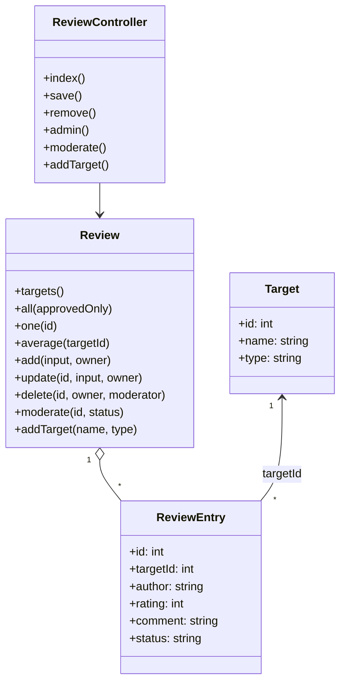

# Diagramme de classes - module Avis

Dans ce prototype JSON, la relation `ReviewEntry.targetId -> Target.id` permet d'afficher le commerce/événement/lieu de chaque avis. Cela n'est pas une jointure SQL ; dans la version BDD, utiliser une clé étrangère et un JOIN.
